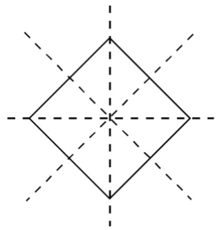
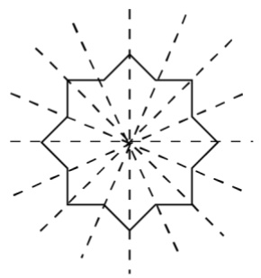
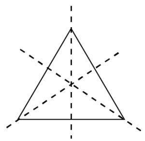
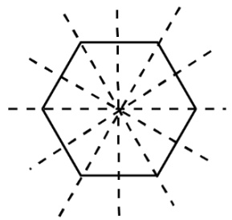
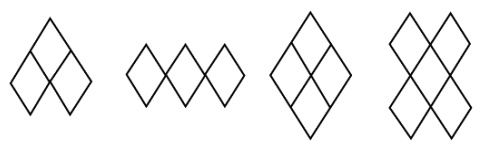
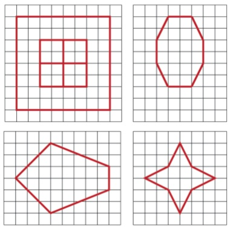

**Q6. How many lines of symmetry do these shapes have? Ans. a.**

4 Lines of Symmetry

8 Lines of Symmetry

**b. A triangle with equal sides and equal angles.**

3 Lines of Symmetry

**c. A hexagon with equal sides and equal angles.**

6 Lines of Symmetry

**Q7. Trace each figure and draw the lines of symmetry, if any:**

