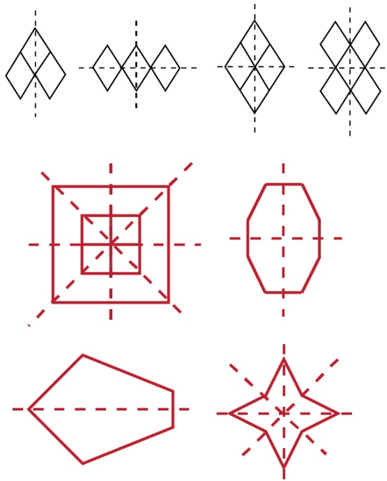
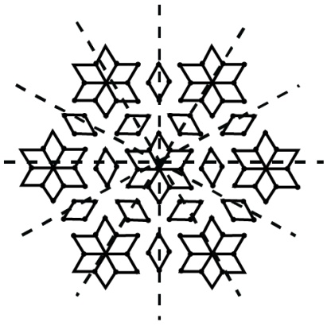

**Ans.**

**Q8. Find the lines of symmetry for the kolam below. Ans.**

**Q9. Draw the following.**

**a. A triangle with exactly one line of symmetry**

**b. A triangle with exactly three lines of symmetry**

**c. A triangle with no line of symmetry**

**Is it possible to draw a triangle with exactly two lines of symmetry?**