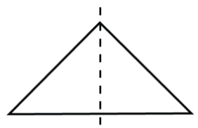
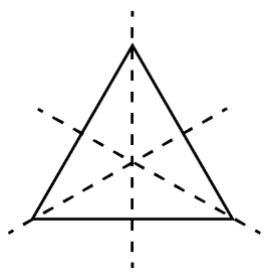
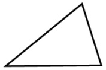
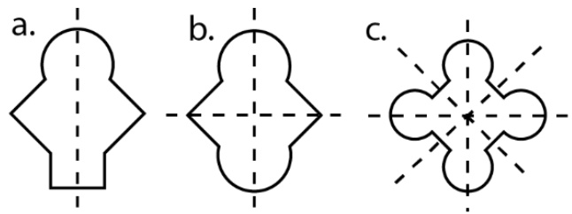

**Ans. a.**

**b.**

**c.**

No, it is not possible to draw a triangle with exactly two lines of symmetry.

**Q10. Draw the following. In each case, the figure should contain at least one curved boundary.**

**a. A figure with exactly one line of Symmetry**

**b. A figure with exactly two lines of symmetry**

**c. A figure with exactly four lines of symmetry**

**Ans.**

