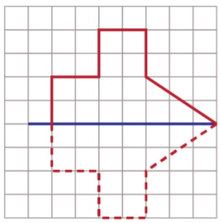
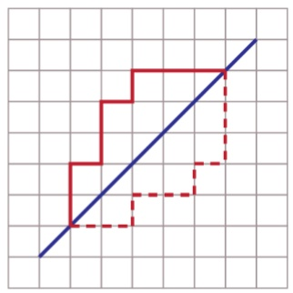
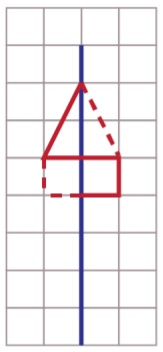
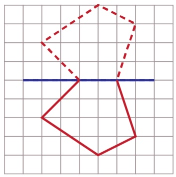
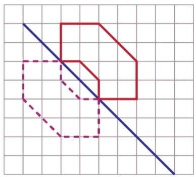

**Q11. Copy the following on squared paper. Complete them so that the blue line is a line of symmetry. Problem (a) has been done for you.** Hint: For (c) and (f), see if rotating the book helps! **Ans.**

(b)

(c)

(d)

(e)

(f)