**Q12. Copy the following drawing on squared paper. Complete each one of them so that the resulting figure has the two blue lines as lines of symmetry.**

## Ans.

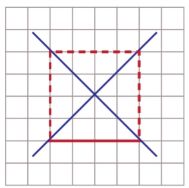

(a)

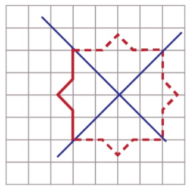

(b)

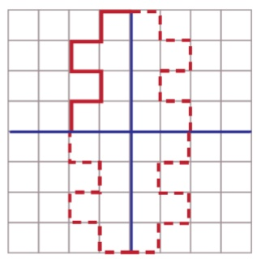

(c)

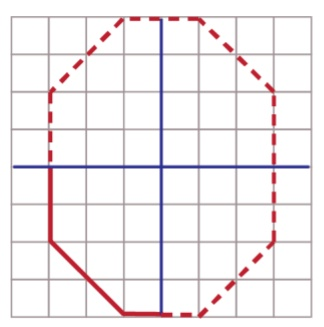

(d)

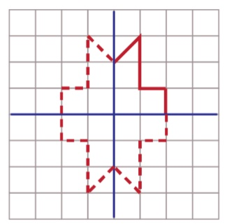

(e)

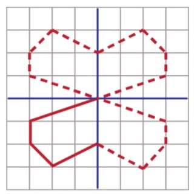

(f)

**Q13. Copy the following on a dot grid. For each figure draw two more lines to make a shape that has a line of symmetry.**

Ans.

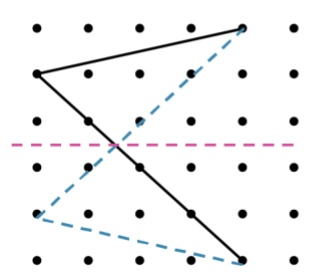

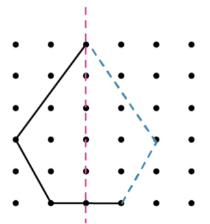

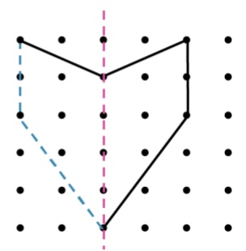

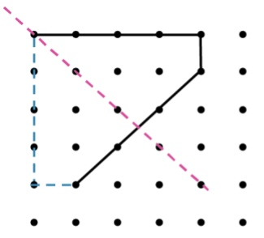

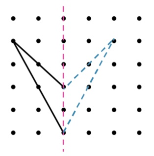

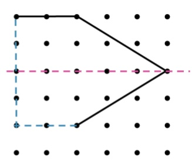