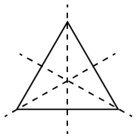
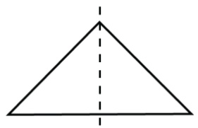
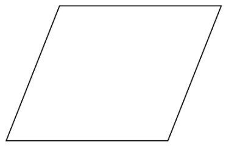

**Q3. Draw, wherever possible, a rough sketch of a. A triangle with at least two lines of symmetry and at least two angles of symmetry. b. A triangle with only one line of symmetry but not having rotational symmetry. c. A quadrilateral with rotational symmetry but no reflection symmetry. d. A quadrilateral with reflection symmetry but not having rotational symmetry.**

**Ans.** a.

3 lines of symmetry 3 angles of symmetry

b.

1 line of symmetry No rotational symmetry

c.

No line of symmetry 2 angles (180°, 360°)