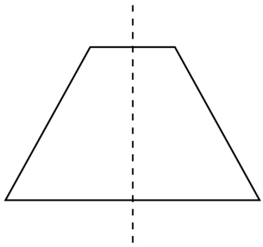

d. A quadrilateral with reflection symmetry but not having rotational symmetry

**Q4. In a figure,** $\mathbf { 6 0 ^ { \circ } }$ **is the smallest angle of symmetry. What are the other angles of symmetry of the figure?**

**Ans.** Other angles of symmetry = 120°, 180°, 240°, 300°, 360°.

**Q5. In the figure, 60° in an angle of symmetry. The figure has two angles of symmetry less then 60°. What is its smallest angle of symmetry?**

**Ans.** The smallest angle of symmetry $= 2 0 ^ { \circ }$

**Q6. Can we have a figure with rotational symmetry whose smallest angle of symmetry is** a. $4 5 ^ { \circ } ?$ b. $1 7 ^ { \circ } ?$

**Ans.** a. yes, as $3 6 0 ^ { \circ }$ is a multiple of $4 5 ^ { \circ }$ b. $\mathrm { { N o } , }$ as $3 6 0 ^ { \circ }$ is not a multiple of $1 7 ^ { \circ } ,$

**Q7. This is a picture of the new Parliament Building in Delhi.**

**a. Does the outer boundary of the picture have reflection symmetry? If so, draw the lines of symmetries. How many are they?**

**b. Does it have rotational symmetry around its centre? If so, find the angles of rotational symmetry.**

**Ans.** a. Yes, the outer boundary of the picture has 3 lines of symmetry. b. Yes, the outer boundary has rotational symmetry. The angles of rotational symmetry are 120°, 240°, 360°.