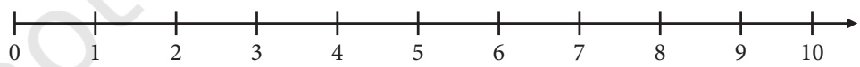

# THE OTHER SIDE OF ZERO

V Integers

0674CH10

**More and more numbers!**

Recall that the very first numbers we learned about in the study of mathematics were the counting numbers 1, 2, 3, 4, …

Then we learned that there are even more numbers! For example, there is the number 0 (zero), representing nothing, which comes before 1. The number 0 has a very important history in India and now in the world. For example, around the world we learn to write numbers in the Indian number system using the digits 0 to 9, allowing us to write numbers however large or however small using just these 10 digits.

We then learned about more numbers that exist between the numbers 0, 1, 2, 3, 4, … , such as $\frac{1}{2} , \quad \frac{3}{2} , \quad  and  \quad \frac{13}{6}$ . These are called fractions.

But are there still more numbers? Well, 0 is an additional number that we didn’t know about earlier, and it comes before 1 and is less than 1. Are there perhaps more numbers that come before 0 and are less than 0?

Phrased another way, we have seen the number line:

However, this is actually only a number ‘ray’, in the language we learned earlier in geometry; this ray starts at 0 and goes forever to the right. Do there exist numbers to the left of 0, so that this number ray can be completed to a true number line?

That is what we will investigate in this chapter!