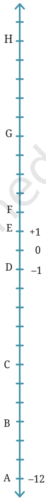

Floor +3 is lower than Floor +4. So, we write +3 < +4. We also write +4 > +3.

Should we write –3 < – 4 or – 4 < – 3?

Floor – 4 is lower than Floor – 3. So, – 4 < – 3. It is also correct to write – 3 > – 4

## Figure it Out

1. Compare the following numbers using the Building of Fun and fill in the boxes with < or >.

a. $-2 \xrightarrow{ 一 } +5$

d. $+6 \bigtriangleup -6$

b. – 5 +4

c. – 5 – 3

e. 0 –4

f. 0 +4

Notice that all negative number floors are below Floor 0. So, all negative numbers are less than 0. All the positive number floors are above Floor 0. So, all positive numbers are greater than 0.

2. Imagine the Building of Fun with more floors. Compare the numbers and fill in the boxes with < or >:

$$
\begin{array}{l}\text { a. } -10 \text { } \text { } \text { } \text { } \text { } \text { } \text { } \text { } \text { } \text { } \text { } \text { } \text { } \text { } \text { } \text { } \text { } \text { } \text { } \text { } \text { } \text { } \text { } \text { } \text { } \text { } \text { } \text { } \text { } \text { } \text { } \text { } \text { } \text { } \text { } \text { } \text { } \text { } \text { } \text { } \text { } \text { } \text { } \text { } \text { } \text { } \text { } \text { } \text { } \text { } \text { } \text { } \text { } \text { } \text { } \text { } \text { } \text { } \text { } \text { } \text { } \text { } \text { } \text { } \text { } \text { } \text { } \text { } \text { } \text { } \text { } \text { } \text { } \text { } \text { } \text { } \text { } \text { } \text { } \text { } \text { } \text { } \text { } \text { } \text { } \text { } \text { } \text { } \text { } \text { } \text { } \text { } \text { } \text { } \text { } \text { } \text { } \text { } \text { } \text { } \text { } \text { } \text { } \text { } \text { } \text { } \text { } \text { } \text { } \text { } \text { } \text { } \text { } \text { } \text { } \text { } \text { } \text { } \text { } \text { } \text { } \text { } \text { } \text { } \text { } \text { } \text { } \text { } \text { } \text { } \text { } \text { } \text { } \text { } \text { } \text { } \text { } \text { } \text { } \text { } \text { } \text { } \text { } \text { } \text { } \text { } \text { } \text { } \text { } \text { } \text { } \text { } \text { } \text { } \text { } \text { } \text { } \text { } \text { } \text { } \text { } \text { } \text { } \text { } \text { } \text { } \text { } \text { } \text { } \text { } \text { } \text { } \text { } \text { } \text { } \text { } \text { } \text { } \text { } \text { } \text { } \text { } \text { } \text { } \text { } \text { } \text { } \text { } \text { } \text { } \text \text { } \text { } \text { } \text { } \text { } \text { } \text { } \text { } \text { } \text \text { } \text { } \text { } \text { } \text { } \text { } \text \text { } \text { } \text { } \text { } \text { } \text \text { } \text { } \text { } \text { } \text { \end{array}
$$

$$
\begin{array}{l}\text { b. } + 17 \text { } \text { } \text { } \text { } \text { } \text { } \text { } \text { } \text { } \text { } \text { } \text { } \text { } \text { } \text { } \text { } \text { } \text { } \text { } \text { } \text { } \text { } \text { } \text { } \text { } \text { } \text { } \text { } \text { } \text { } \text { } \text { } \text { } \text { } \text { } \text { } \text { } \text { } \text { } \text { } \text { } \text { } \text { } \text { } \text { } \text { } \text { } \text { } \text { } \text { } \text { } \text { } \text { } \text { } \text { } \text { } \text { } \text { } \text { } \text { } \text { } \text { } \text { } \text { } \text { } \text { } \text { } \text { } \text { } \text { } \text { } \text { } \text { } \text { } \text { } \text { } \text { } \text { } \text { } \text { } \text { } \text { } \text { } \text { } \text { } \text { } \text { } \text { } \text { } \text { } \text { } \text { } \text { } \text { } \text { } \text { } \text { } \text { } \text { } \text { } \text { } \text { } \text { } \text { } \text { } \text { } \text { } \text { } \text { } \text { } \text { } \text { } \text { } \text { } \text { } \text { } \text { } \text { } \text { } \text { } \text { } \text { } \text { } \text { } \text { } \text { } \text { } \text { } \text { } \text { } \text { } \text { } \text { } \text { } \text { } \text { } \text { } \text { } \text { } \text { } \text { } \text { } \text { } \text { } \text { } \text { } \text { } \text { } \text { } \text { } \text { } \text { } \text { } \text { } \text { } \text { } \text { } \text { } \text { } \text { } \text { } \text { } \text { } \text { } \text { } \text { } \text { } \text { } \text { } \text { } \text { } \text { } \text { } \text { } \text { } \text { } \text { } \text { } \text { } \text { } \text { } \text { } \text { } \text { } \text { } \text { } \text { } \text { } \text { } \text { } \text { } \text { } \text { } \text { } \text { } \text { } \text { } \text { } \text \text { } \text { } \text { } \text { } \text { } \text { } \text { } \text \text { } \text { } \text { } \text { } \text { } \text \text { } \text { } \text { } \text { } \text { } \end{array}
$$

3. If Floor A = –12, Floor D = –1 and Floor E = +1 in the building shown on the right as a line, find the numbers of Floors B, C, F, G, and H.

4. Mark the following floors of the building shown on the right. a. – 7 b. –   4 c. + 3 d. –   10

## Subtraction to find which button to press

In earlier classes, we understood the meaning of subtraction as ‘take away’. For example, there are 10 books on the shelf. I take away 4 books. How many are left on the shelf?

We can express the answer using subtraction: 10 – 4 = 6 or ‘Ten take away four is six.