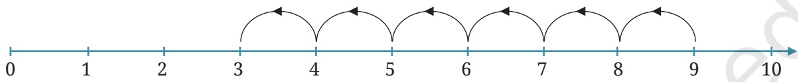
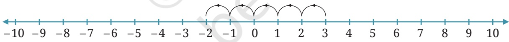
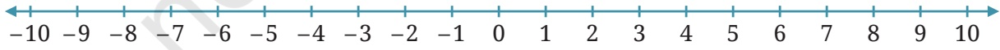

You must travel 4 steps. That is why 5 + 4 = 9.

(Remember: **Starting Number + Movement = Target Number**)

The corresponding subtraction statement is 9 – 5 = 4.

(Remember: **Target Number – Starting Number = Movement needed**)

Now, from 9, if you wish to go to 3, how much must you travel along the number line?

You must move 6 steps backward, i.e., you must move –6. Hence, we write 9 + (–6) = 3.

(Remember again : **Starting Number + Movement = Target Number**)

The corresponding subtraction statement is 3–9=–6.

(Remember again: **Target Number – Starting Number = Movement needed**)

Now, from 3, if you wish to go to – 2, how far must you travel?

You must travel –5 steps, i.e., 5 steps backward. Thus, 3+(–5)=–2. The corresponding subtraction statement is: –2 –3=–5.

## Figure it Out

1. Mark 3 positive numbers and 3 negative numbers on the number line above.

2. Write down the above 3 marked negative numbers in the following boxes: