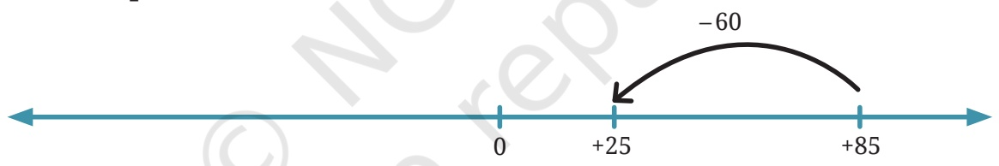
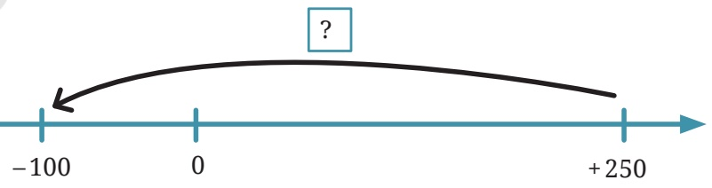

3. Is 2 > – 3? Why? Is – 2 < 3? Why?

4. What are a. –5+0 b. 7+(–7) c. –10+20 d. 10 –20 e. 7–(–7) f. –8–(–10)?

## Using the unmarked number line to add and subtract

Just as you can do additions, subtractions and comparisons with small numbers using the number line above, you can also do them with large numbers by imagining an ‘infinite number line’ or drawing an ‘unmarked number line’ as follows:

This line shows only the position of zero. Other numbers are not marked. It can be convenient to use this unmarked number line to add and subtract integers. You can show, or simply imagine, the scale of the number line and the positions of numbers on it.

For example, this unmarked number line (UNL) shows the addition problem: 85 + (– 60) = ?

We then can visualise that 85 + (– 60) = 25

The following UNL shows a subtraction problem which can also be written as a missing addend problem: (–100)–(+250) = ? or 250 + ? = –100.

We can then visualise that ? = –350 in this problem.

In this way, you can carry out addition and subtraction problems, with positive and negative numbers, on paper or in your head using an unmarked number line.