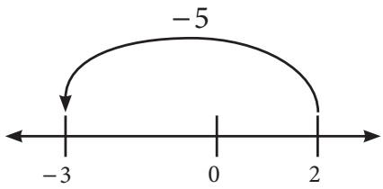

Use unmarked number lines to evaluate these expressions:

a. – 125 + (– 30) = \_\_\_\_\_\_

b. +105 – (–55) = \_

c. +80 – (–150) =

d. –99 – (–200) = \_\_

**Converting subtraction to addition and addition to subtraction**

Recall that **Target Floor – Starting Floor = Movement needed**

## or

**Target Floor = Starting Floor + Movement needed**

If we start at 2 and wish to go to –3, what is the movement needed?

**First method:** Looking at the number line, we see we need to move –5 (i.e., 5 in the backward direction). Therefore, **– 3 – 2 = – 5**. The movement needed is –5.

**Second method:** Break the journey from 2 to –3 into two parts.

a. From 2 to 0, the movement is 0–2=–2.

b. From 0 to –3, the movement is –3–0=–3.

The total movement is the sum of the two movements: **– 3 + (– 2) = – 5**.

Look at the two coloured expressions. There is no subtraction in the second one!

In this way, we can always convert subtraction to addition. **The number that is being subtracted can be replaced by its inverse and then added instead.**

**Similarly, a number that is being added can be replaced by its inverse and then subtracted.** In this way, we can also always convert addition to subtraction.

**Examples:**

$$
(+7)-(+5)=(+7)+(-5)
$$

b. (– 3) – (+ 8) = (– 3) + (– 8)

c. (+ 8) –(–2) = (+ 8) + (+ 2)

d. (+ 6) – (– 9) = (+ 6) + (+ 9)