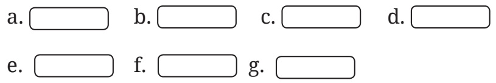
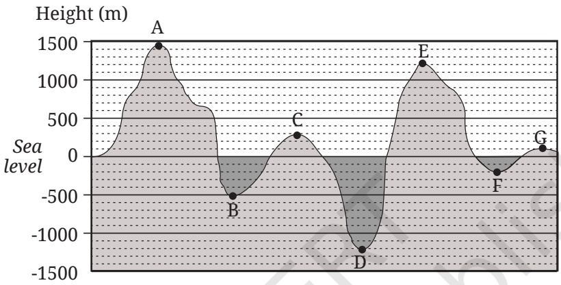

## Figure it Out

1. Looking at the geographical cross section, fill in the respective heights:

## Teacher’s Note

Ask what a geographical cross section is by showing the figure in this page. It is like imagining a vertical slice taken out at some location on the Earth. This is what would be seen from a side view. Discuss the notion of ‘sea level’ for measuring heights and depths in geography.

2. Which is the highest point in this geographical cross section? Which is the lowest point?

3. Can you write the points A, B, …, G in a sequence of decreasing order of heights? Can you write the points in a sequence of increasing order of heights?

4. What is the highest point above sea level on Earth? What is its height?

5. What is the lowest point with respect to sea level on land or on the ocean floor? What is its height? (This height should be negative).