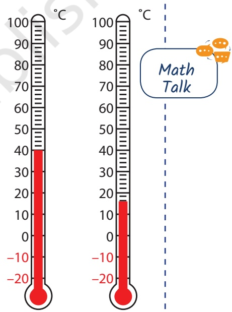

## Temperature

During summer time you would have heard in the news that there is a ‘heat wave’. What do you think will be the temperature during the summer when you feel very hot? In the winter we have cooler or colder temperatures.

What has been the maximum temperature during the summer and the minimum temperature during the winter last year in your area? Find out.

When we measure temperature, we use Celsius as the unit of measure $( ^ { \circ } \mathbb { C } )$ . The thermometers below are showing $4 0 ^ { \circ } \mathbb { C }$ and $1 5 ^ { \circ } \mathrm { C }$ temperatures.

## Figure it Out

1. Do you know that there are some places in India where temperatures can go below $0 ^ { \circ } \mathbb { C } ?$ Find out the places in India where temperatures sometimes go below $0 ^ { \circ } \mathsf { C }$ What is common among these places? Why does it become colder there and not in other places?

2. Leh in Ladakh gets very cold during the winter. The following is a table of temperature readings taken during different times of the day and night in Leh on a day in November. Match the temperature with the appropriate time of the day and night.

| Temperature |
| --- |
| 14°C |
| 8°C |
| -2°C |
| -4°C |

| Time |
| --- |
| 02:00 a.m. |
| 11:00 p.m. |
| 02:00 p.m. |
| 11:00 a.m. |