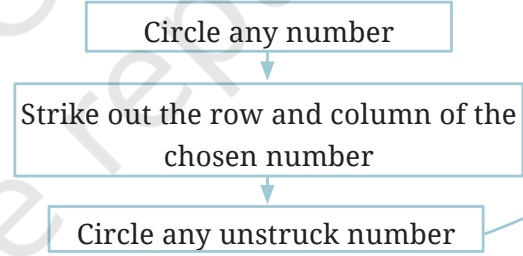
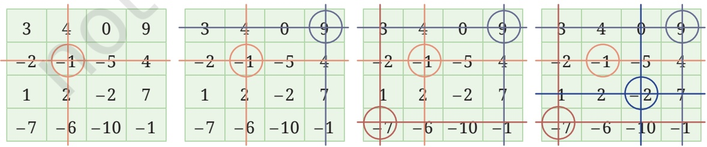

2. Complete the grids to make the required border sum:

| -10 |  |  |
| --- | --- | --- |
|  |  | -5 |
| 9 |  |  |

Border sum is +4

| 6 | 8 |  |
| --- | --- | --- |
|  |  | -5 |
|  | -2 |  |

Border sum is – 2

| 7 |  |  |
| --- | --- | --- |
|  |  | -5 |
|  |  |  |

Border sum is – 4

3. For the last grid above, find more than one way of filling the numbers to get border sum –4.

4. Which other grids can be filled in multiple ways? What could be the reason?

5. Make a border integer square puzzle and challenge your classmates.

## An amazing grid of numbers!

Below is a grid having some numbers. Follow the steps as shown until no number is left.

| 3 | 4 | 0 | 9 |
| --- | --- | --- | --- |
| -2 | -1 | -5 | 4 |
| 1 | 2 | -2 | 7 |
| -7 | -6 | -10 | -1 |

Strike out the row and column of the chosen number

When there are no more unstruck numbers, STOP. Add the circled numbers.

In the example below, the circled numbers are – 1, 9, – 7, – 2. If you add them, you get –1.

