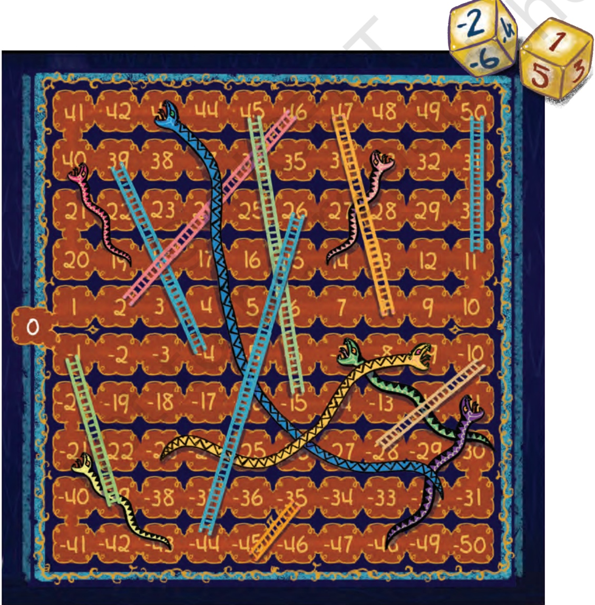

## Integers: Snakes and Ladders

## Rules

This is a two player game. Each player has 1 pawn. Both players start at 0. Players can reach either – 50 or + 50 to win but need not decide or fix this before or during play.

Each player rolls two dice at a time. One dice has numbers from + 1 to + 6 and the other dice has numbers from – 1 to – 6.

After each roll of the two dice, the player can add or subtract them in any order and then move the steps that indicate the result. A positive result means moving towards + 50 and a negative result means moving towards – 50.

