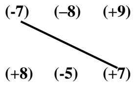

**Q.3. Starting from different floors, find the movements required to reach Floor – 5. For example, if I start at Floor + 2, I must press – 7 to reach Floor – 5. The expression is (+ 2) + (– 7) = – 5.**

**Find more such starting positions and the movements needed to reach Floor – 5 and write the expressions.**

Ans. Starting floor + Movement = Target Floor +1 + (-6) = (-5) -2 + (-3) = (-5) 0 + (-5) = (-5) (Try more possibilities)

## Page No. 246

**Figure it out**

**Q. Evaluate these expressions by thinking of them as the resulting movement of combining button presses:** a. (+ 1) + (+ 4) = b. (+ 4) + (+ 1) = c. (+ 4) + (– 3) + (– 2) = d. (– 1) + (+ 2) + (– 3) = Ans. a. (+5) b. (+5) c. (-1) d. (-2)

**Q. Write the inverses of these numbers:**

Ans. Inverse of +4 = -4 Inverse of -4 = +4 Inverse of -3 = +3 Inverse of 0 = 0 Inverse of +2 = (-2) Inverse of -1 = +1

**Q. Connect the inverses by drawing lines.**

**(+5)**

**(–9)**

