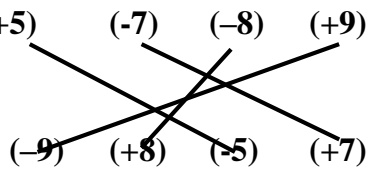

Ans. **(+5)**

**Q. Who is on the lowest floor?**

**1. Jay is in the Art Centre. So, he is on Floor +2.**

2. Asin is in the Sports Centre. So, she is on Floor

3. Binnu is in the Cinema Centre. So, she is on Floor

4. Aman is in the Toys Shop. So, he is on Floor

Ans. Binnu is on the lowest floor.

1. +2 2. +5 3. -3 4. -1

**Page No. 247**

**Figure it out**

**Q.1. Compare the following numbers using the Building of Fun and fill in the boxes with < or >.**

Ans. a. $(-2)^{  一  } + 5$

b. $\left( -5 \right) \boxed{ \quad } +4$

c. $(-5)^{\boxed{ \quad }} -3$

$$
\mathbf{d}_{\mathbf{e}} + \mathbf{6} \bigsqcup \mathbf{-6}
$$

**e. 0 – 4**

**f. 0 + 4**

Ans. a. <

b. <

c. <

d. >

e. >

f. <

**Q.2. Imagine the Building of Fun with more floors. Compare the numbers and fill in the boxes with < or >:**

b. $$+ \left. \mathbf { 1 7 } \right. \boxed { \quad } \left. \left( - \mathbf { 1 0 } \right) \right.$$ a.a. $\left (  -10 \right ) \overline{\overline{\overline{ 刂 }}} \left (  -12 \right )$ c. $\mathbf{0}  一  \begin{aligned} &  一  \\ \end{aligned} \begin{aligned} (-20) \end{aligned}$ e. $(-25) \boxed{ \quad } (-7)$ A . . ns a >

**f. + 15 (–17)**<

b. > c. > d. > e. < f. >