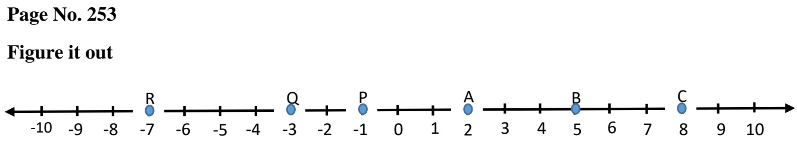
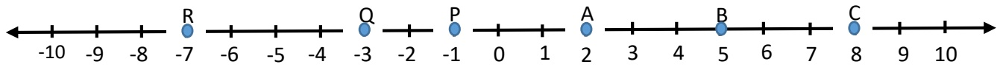

## Page No. 251

## Figure it out

**Q. Complete these expressions.**

a. (+ 40) + = + 200

b. (+ 40) + \_ \_ = – 200

c. (– 50) + = + 200

d. (– 50) + \_ = – 200

e. (– 200) – (– 40) =

f. (+ 200) – (+ 40) =

g. (– 200) – (+ 40) =

Ans. a. (+160) b. (-240) c. (+250) d. (-150) e. (-160) f. (+160) g. (-240)

## Page No. 252

**Q. In the other exercises that you did above, did you notice that subtracting a negative number was the same as adding the corresponding positive number?**

Ans. Yes. The infinite lift reminds us of a number line.

**Q. If, from 5 you wish to go over to 9, how far must you travel along the number line?** Ans. 4 steps.

**Q. Now, from 9, if you wish to go to 3, how much must you travel along the number line?** Ans. One must travel 6 steps backward or move (-6) from 9 to go to 3.

**Q. Now, from 3, if you wish to go to – 2, how far must you travel?**

Ans. One must travel 5 steps backward or move (-5) from 3 to go to -2.

**Page No. 253**

**Figure it out**

**Q1. Mark 3 positive numbers and 3 negative numbers on the number line above.**

Ans. Mark A = 2, B = 5, C = 8

P = -1, Q = -3, R = -7

(Try other possibilities)