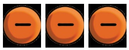
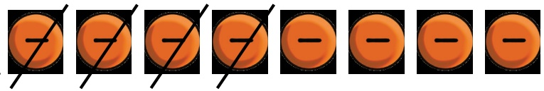
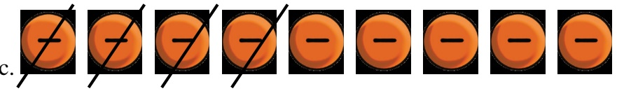
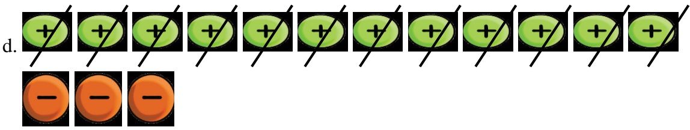
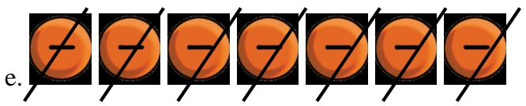

Ans. a. (+3) + (-5) = (-2) Attendant is at (-2) Floor

c. (-2) d. (+4)

**Q.2. Cancel the zero pairs in the following two sets of tokens. On what floor is the lift attendant in each case? What is the corresponding addition statement in each case?**

**a.**

**b.**

(+6) + (-3) = (+3)

b.

Attendant is at (+3) Floor

**Page No. 258**

**Figure it out**

**Q.1. Evaluate the following differences using tokens. Check that you get the same result as with other methods you now know: a. (+ 10) – (+ 7) b. (– 8) – (– 4) c. (– 9) – (– 4) d. (+ 9) – (+ 12) e. (– 5) – (– 7) f. (– 2) – (– 6)**

Ans. a.

(+10) – (+7) = (+3)

(-8) – (-4) = (-8) + (+4) = (-4)

(-9) – (-4) = (-9) + (+4) = (-5)

d.

(+9) – (+12) = (-3)

