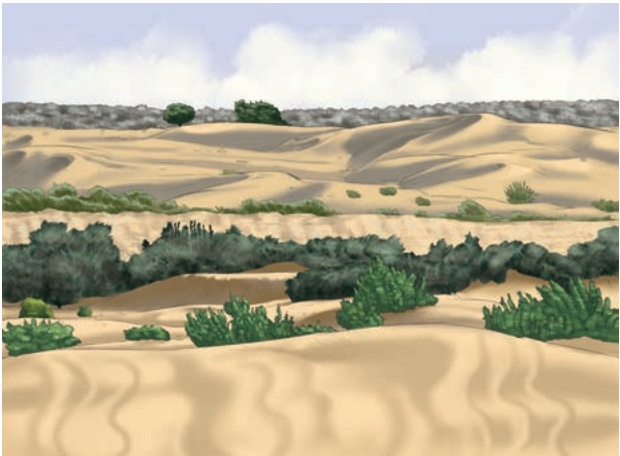
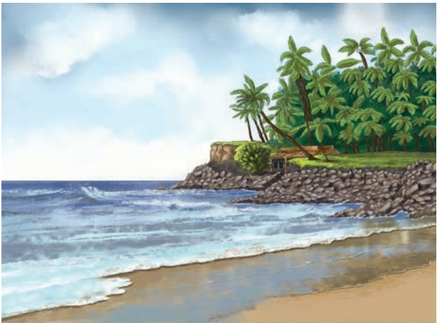
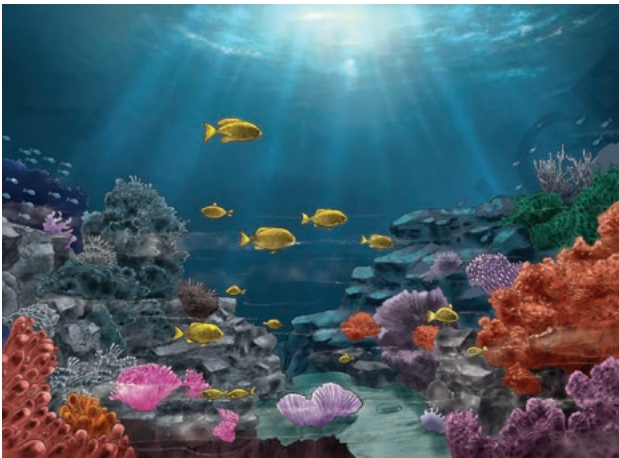
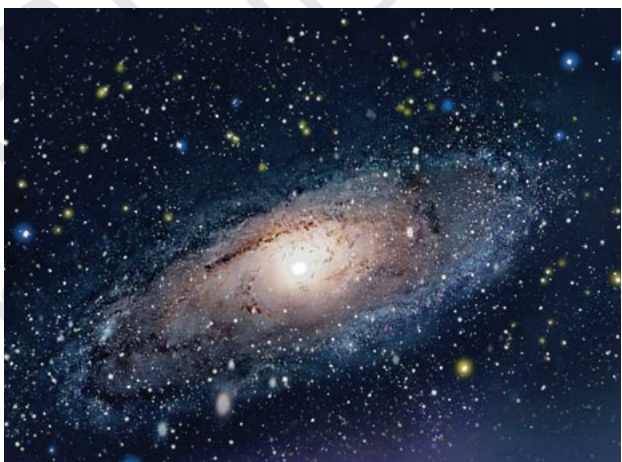

A Desert

A Coast

vastness of outer space, from what is cooking in the kitchen to what is happening on the playground, some of the most groundbreaking discoveries have often come from unexpected places.

An underwater view of an Ocean

A Galaxy

Science is like a giant and unending jigsaw puzzle. Every new discovery we make adds another piece to that puzzle. And you know the best thing about this puzzle? There is no limit to what we can discover, since every new piece of knowledge leads to more questions and more things to find out. Sometimes, we find that a piece of this puzzle has been put in the wrong place and needs to be moved. New discoveries often change our understanding of the world.

As you go through this book, you will encounter interesting ideas, do some thought-provoking experiments, and see how some of what we will find out is useful in our