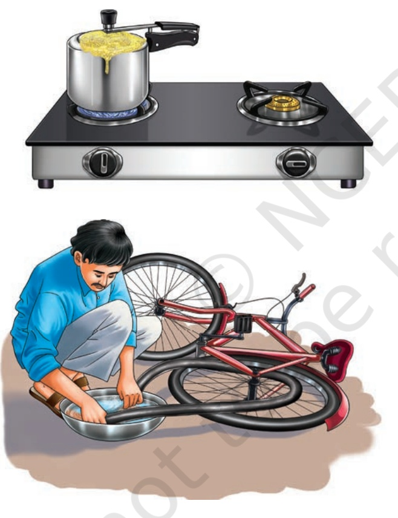

| First, we observe something that we find interestingor we do not understand. |
| --- |
| This makes us wonder and perhaps think of a questionabout it. |
| Then, we guess a possible answer to that question. |
| We test this guess through experiments or moreobservations. |
| We then try to analyse the results to see if it actually answersour question. |

Scientists are people who follow the scientific method to solve problems or to discover new things. But anyone who follows the scientific method is working like a scientist. Someone cooking food may be wondering why the dal has spilled out of the cooker—was there too much water?

Think of a bicycle repair person trying to find out why a tyre is flat—from where did the air leak out? Or an electrician trying to find why a light bulb is not working—is there some problem with the bulb or the switch? When we try to ask questions and find out answers, we are all, in a way, scientists!

## Activity 1.2: Let us think and write

‹ Describe a daily life situation where you think someone was following a scientific method.

Do you now realise that there are several daily-life situations where we knowingly or unknowingly apply the scientific