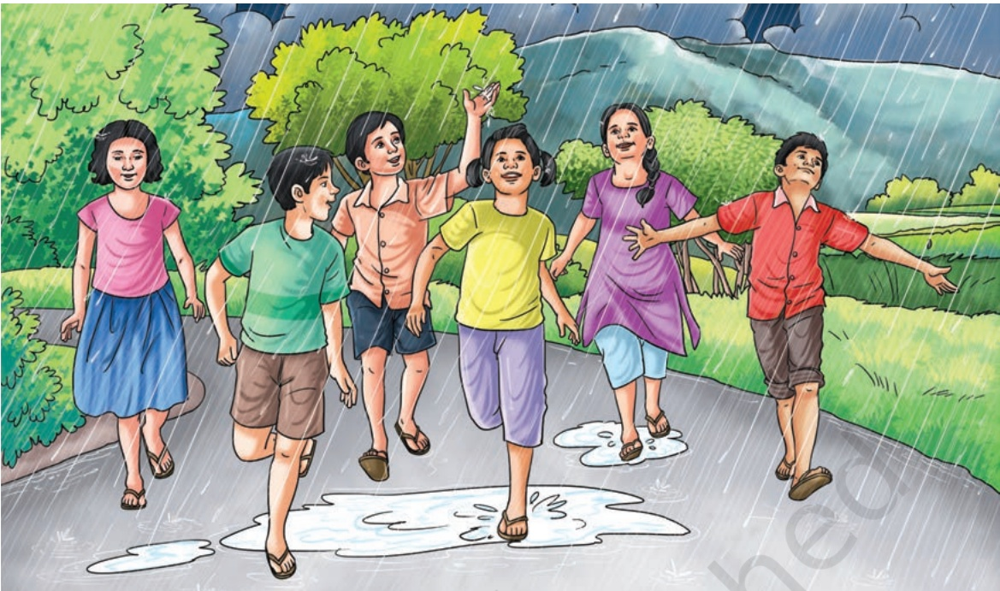

Much like children enjoying the rain, science is all about joyful exploration. Enjoy your scientific journey, keep exploring and never stop wondering about the amazing mysteries of the universe and asking questions.

**After all, to be a wise person, you must be a “whys” person!**

?

Are you ready to embark upon the exciting journey of science? Let us get started!!