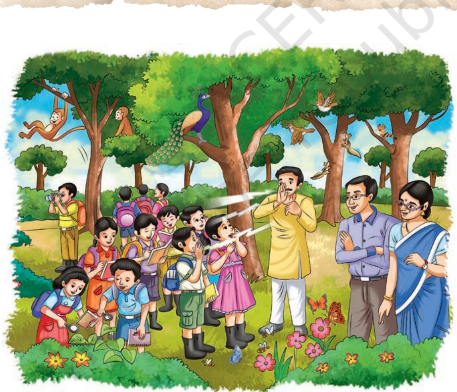

## Chapter Diversity in the Living World

**छायामन्यस्य कु र्वन्ति तिष्ठन्ति स्वयमातपे । फलान्यपि परार्थाय वकृ ्षाः सत्पुरुषा इव ॥**

**(सभाु षित)**

0677CH02

Trees stand in the Sun and give shade to others. Their fruits are also for others. Likewise, good people bear all hardships and bring welfare to others. They give to others whatever they have earned.

(Wise saying)

It is a pleasant morning after yesterday’s refreshing rain. Dr Raghu and Maniram chacha (uncle) have been invited to the school by the science teacher, Madam Sulekha, to