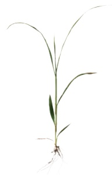
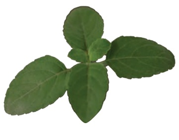
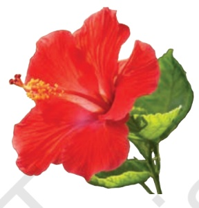

You can collect different types of fallen leaves or flowers and **create** a scrapbook.

‹ Take care of the plants and animals in nature. Ensure that you do not disturb the plants and animals in the park. Do not pluck leaves and flowers.

‹ **Record** your observations in Table 2.1 about the features of stems, leaves, flowers and anything interesting in various plants. Some examples have been given for you in Fig. 2.1 and Table 2.1.

(a) Grass

(b) Tulsi (Holy Basil)

(c) Hibiscus (Gudhal)

Fig. 2.1: Examples of different features of some plants

Table 2.1: Observations of different plants around us

| S. no. | Local name of plant | Stem | Leaves (shape/ arrangement of leaves) | Any other Flowers observations and features |
| --- | --- | --- | --- | --- |
| 1. | Common grass | Soft and thin | A single leaf grows alternatively from different points on the stem | Green leaves |
| 2. | Tulsi | Hard and thin | Arrangement of a pair of leaves in the opposite directions | Pinkish purple |
| 3. | Hibiscus | Hard |  |  |
| 4. | Neem | Hard and thick |  | Leaves with smooth surface |
| 5. | Any other |  |  |  |