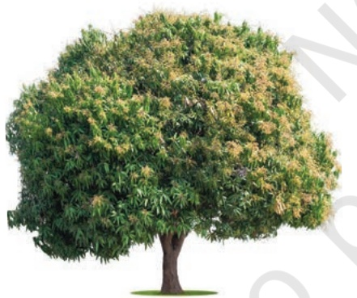
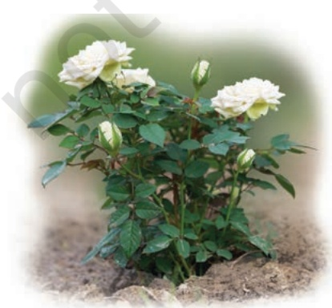
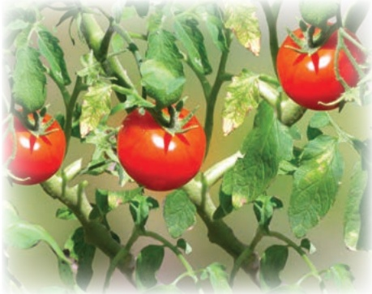

Table 2.3: Grouping of plants based on height and nature of stem

<table><tr><td rowspan="2">S. no.</td><td rowspan="2">Name of the plant</td><td>Height</td><td colspan="3">Nature of stem</td><td colspan="2">Appearance of branches</td><td rowspan="2">Name of plant group</td></tr><tr><td>Short/ Medium/ Tall</td><td>Green/ Brown</td><td>Tender/ Hard</td><td>Thick/ Thin</td><td>Close to the ground</td><td>Higher up on the stem</td></tr><tr><td>1.</td><td>Mango</td><td>Tall</td><td>Brown</td><td>Hard</td><td>Thick</td><td></td><td>Yes</td><td>Tree</td></tr><tr><td>2.</td><td>Rose</td><td>Medium</td><td>Brown</td><td>Hard</td><td>Thin</td><td>Yes</td><td></td><td>Shrub</td></tr><tr><td>3.</td><td>Tomato</td><td>Short</td><td>Green</td><td>Tender</td><td>Thin</td><td>Yes</td><td></td><td>Herb</td></tr><tr><td></td><td></td><td></td><td></td><td></td><td></td><td></td><td></td><td></td></tr><tr><td></td><td></td><td></td><td></td><td></td><td></td><td></td><td></td><td></td></tr><tr><td></td><td></td><td></td><td></td><td></td><td></td><td></td><td></td><td></td></tr><tr><td></td><td></td><td></td><td></td><td></td><td></td><td></td><td></td><td></td></tr></table>

(a) Tree

What differences do you observe among herbs, shrubs, and trees? How can you group plants as herbs, shrubs, and trees based on the data entered in Table 2.3?

Some plants grow really tall and have hard, thick, brown, and woody stems. Their branches typically start higher up on the stem and away from the ground. These plants are called **trees**. For example, a mango tree (Fig. 2.3a).

