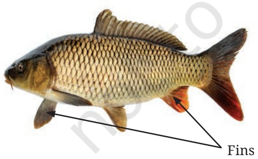
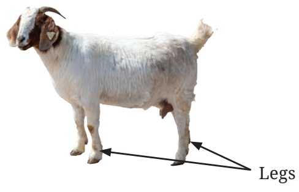

## Success Story—Save Silent Valley Movement

This is a real story of a forest in the Palakkad district of Kerala. It is about preserving untouched beauty of a moist evergreen forest and its rich biodiversity. The now-famous Silent Valley was saved by a remarkable movement led by common people who were not even residing in the vicinity of the forest. The battle against the proposal of a hydroelectric dam across the Kunthipuzha river persisted for 10 years. At that time, people used all possible available means, such as widespread awareness programmes, letters to editors, articles in, newspapers, seminars, and petitions and appeals in court. The movement was successful in saving the Silent Valley.

**More to know!**

## 2.3	 Plants and Animals in Different Surroundings

You might have observed during nature walks that different animals live in different surroundings. You have also recorded movement of animals in Table 2.5. Does the movement of these animals depend upon their surroundings? Let us consider fishes and goat as examples. Fishes live in water. They have streamlined bodies and fins for movement in water (Fig. 2.8a). Goats live in grassy areas and move with the help of legs (Fig. 2.8b). The sizes and shapes of animals also differ from one another.

(a) A fish swims in water with the help of fins

(b) A goat walks on the ground with the help of legs

Fig. 2.8: Body parts used by animals for movement