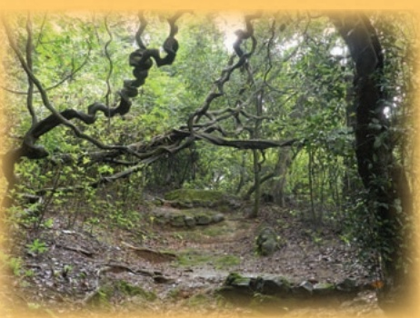

## Traditionally Protected Forests: Sacred Groves

Sacred groves are undisturbed patches of forests. Their sizes may vary from quite small to very large. Sacred groves are found all over India. They are home to different kinds of

Sacred grove from the Western Ghats

plants and animals, including numerous medicinal plants. These are protected by the local community and no one is allowed to harm any animals and cut trees in these groves, or disturb the area. This way, sacred groves are a community protected treasure of biodiversity. M Find out about the sacred groves in your region.

**More to know!**

We must protect biodiversity to ensure our planet is full of life, helping plants and animals to survive and thrive.

**Keywords**

Adaptation

Monocot plants

Analyse

Amphibians

Parallel venation

Compare

Aquatic

Reticulate venation

Create

Biodiversity

Sacred groves

Explore

Cotyledon

Shrubs

Group

Dicot plants

Taproot

Observe

Fibrous root

Terrestrial

Record

Habitat

Tree

Relate

Herbs

Venation