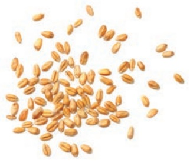
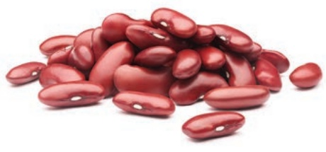
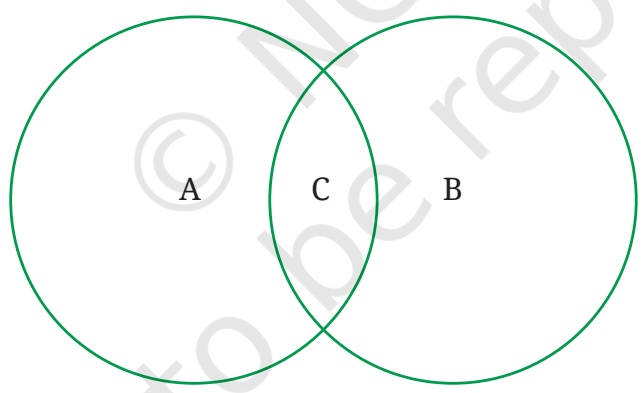

## Let us enhance our learning

1. Here are two types of seeds. What differences do you find among the roots and leaf venation of their plants?

(a) Wheat

(b) Kidney beans

2. Names of some animals are given below. Group them based on their habitats. Write the names of aquatic animals in the area marked ‘A’ and terrestrial animals in the area marked ‘B’. Enter the names of animals living in both habitats in part ‘C’.

Horse, Dolphin, Frog, Sheep, Crocodile, Squirrel, Whale, Earthworm, Pigeon, Tortoise

3. Manu’s mother maintains a kitchen garden. One day, she was digging out radish from the soil. She told Manu that radish is a kind of root. Examine a radish and write what type of root it is. What type of venation would you observe in the leaves of radish plant?

4. Look at the image of a mountain goat and a goat found in the plains. Point out the similarities and differences between them. What are the reasons for these differences?