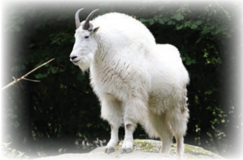
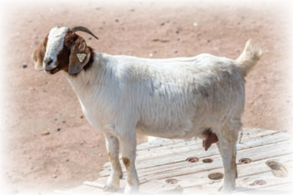
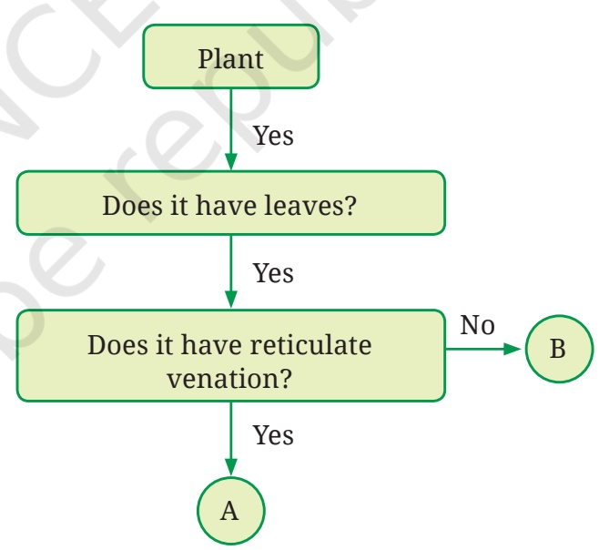

(a) Mountain Goat

(b) Goat found in the plains

5. Group the following animals into two groups based on any feature other than those discussed in the chapter— cow, cockroach, pigeon, bat, tortoise, whale, fish, grasshopper, lizard.

As the population grows and people want more comfortable lives, forests are being cut down to meet various needs. How can this affect our surroundings? How do you think we can address this challenge?

7. Analyse the flowchart. What can be examples of ‘A’ and ‘B’?

8. Raj argues with his friend Sanjay that “Gudhal (hibiscus) plant is a shrub.” What questions can Sanjay ask for clarification?