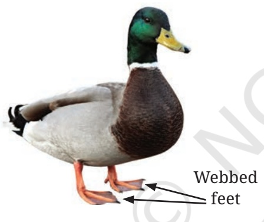
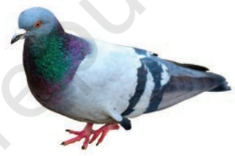

9. Based on the information in the table, find out examples of these plants for each group.

| Group | Type of seed | Type of root | Examples |
| --- | --- | --- | --- |
| A | Dicot | Taproot |  |
| B | Monocot | Fibrous roots |  |

(a) What other similarities do plants of group A have?

(b) What other similarities do plants of group B have?

10. Observe the labelled part of a duck in the picture given below. What differences do you observe in the feet of the duck compared to the other birds? Which activity would the duck be able to perform using this part?

(a) Duck

Webbed feet

(b) Pigeon

## Learning further

‹ Read about one Indian scientist or a wildlife biologist who is working towards protection of India’s biodiversity. Prepare a brief report.

‹ Explore the contributions of Divya Mudappa, Usha Lachungpa, Ghazala Shahabuddin, Nandini Velho, Vidya Athreya, Uma Ramakrishnan and Divya Karnad towards biodiversity in India. Prepare a report of the work done by any three of them.