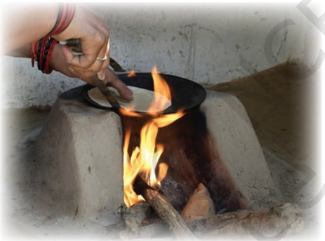
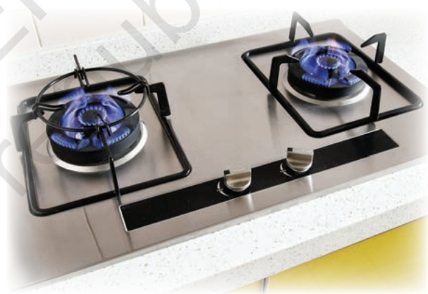
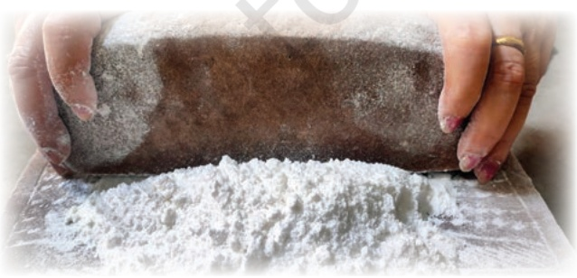

## 3.1.2 How have cooking practices changed over time?

You have learnt that food habits vary across states. Our food choices as well as practices of food preparation may differ from one another. Have our food habits and cooking practices changed over time?

## Activity 3.3: Let us interact and find out

Prepare a list of questions for gathering information from elderly people about their food habits and cooking practices. Following are some of the sample questions—

„ What kind of food do you still eat and what is new?

„ What are the changes in cooking practices over time?

„ What has caused these changes?

Conduct interviews with some elderly people based on the questions prepared.

(a) Chulha (Traditional stove)

(c) Sil-batta (Stone grinder)

(b) Modern gas stove

(d) Electrical grinder

Fig. 3.1: Change in cooking tools over time