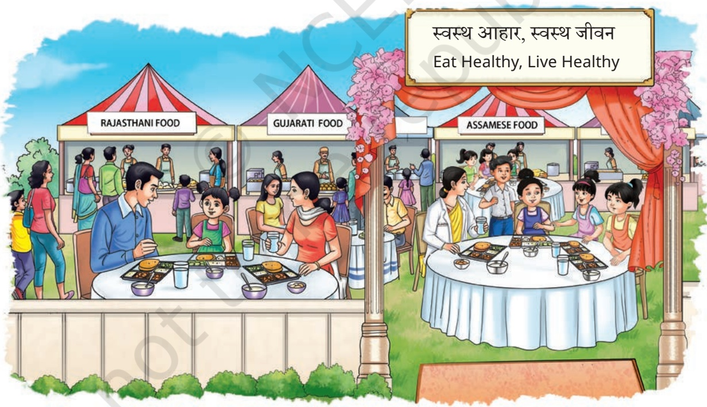

What are your findings from the interviews you conducted? Cooking practices, also called **culinary practices**, have changed over time. There is a significant difference between traditional and modern culinary practices. Earlier, most cooking was done using a chulha (Fig. 3.1a). Nowadays, most of us cook using a modern gas stove (Fig. 3.1b). Earlier, most grinding was done manually using a sil-batta (Fig. 3.1c). These days, we use an electrical grinder for ease of grinding (Fig. 3.1d). Find out what were the other ways of cooking and grinding. Why have these culinary practices changed over time? These changes may be due to factors such as technological development, improved transportation and better communication.

## 3.2 What are the Components of Food?

Medu and Mishti visit the ‘Traditional Food Festival’ organised in their school. The theme of the festival is ‘Eat Healthy, Live Healthy’.

The festival features various stalls displaying different kinds of traditional dishes. Dr Poshita, a nutritional expert, explains to students that ʻHealth is the Ultimate Wealthʼ.