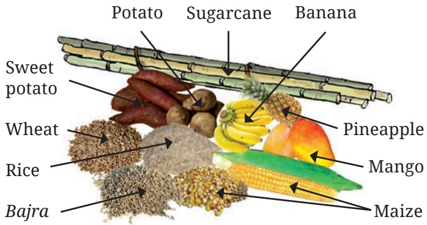
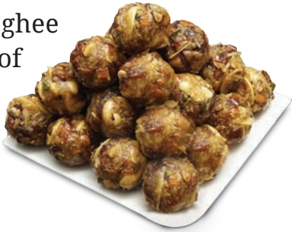

Let us understand what Dr Poshita means by this statement.

Have you ever missed a meal? How do you feel when you miss a meal?

We feel tired and less energetic when we do not eat for some time. Why do you think a marathon runner drinks glucose water during and after a race?

Fig. 3.2: Some sources of carbohydrates

Glucose provides instant energy. Glucose is an example of a carbohydrate. **Carbohydrates** are one of the primary sources of energy in our diet. Cereals like wheat, rice, and maize, vegetables like potato and sweet potato, and fruits like banana, pineapple, and mango are some sources of carbohydrates (Fig. 3.2).

Do you know that common sugar is also a type of carbohydrate?

Why do you think we prefer to have laddoos as a part of our traditional diet in winters?

Besan or wheat flour (aata) and ghe are among the main ingredients of laddoos along with goond (edible gum), nuts, and seeds. Ghee and various kinds of oils are grouped under another kind of food component, which is called **fat**.

Yes, my grandma told me that laddoos rich in ghee and nuts provide energy to keep us warm.

Sources of fats can be from plants or animals (Fig. 3.3). Nuts, such as groundnuts, walnuts, coconuts, and almonds, and seeds, such as pumpkin seeds and sunflower seeds, are some sources of fat. Fat is a source of stored energy.