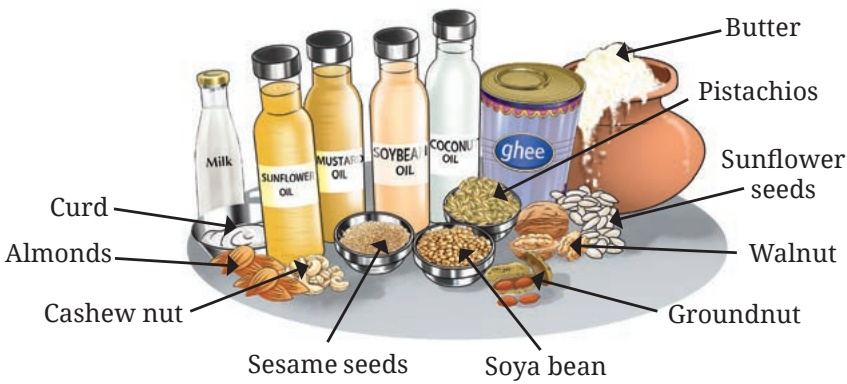
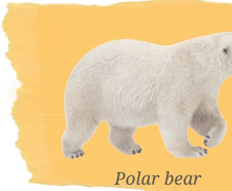
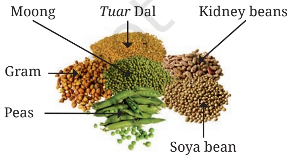
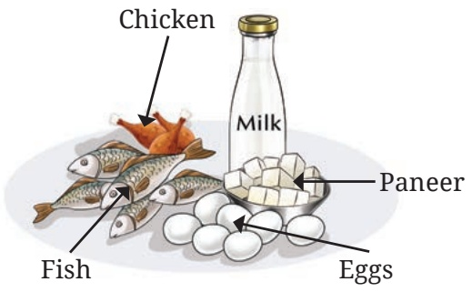

Fig. 3.3: Some sources of fats

Carbohydrates and fats provide us energy for performing various activities. Therefore, they are called **energy-giving foods.** Identify more food items that are rich sources of carbohydrates and fats .

Polar bears accumulate a lot of fat under their skin. This fat serves as an energy source. It supports them during their monthslong winter sleep (hibernation), enabling them to survive without eating.

**More to know!**

**Proteins** are also an important part of our food. Milk products and pulses are good sources of protein. Sportspersons need proteins in larger quantities to build their muscles. People get proteins from plants as well as animals. Some excellent plant sources of protein are pulses, beans, peas and nuts (Fig. 3.4a). Animal sources of protein are milk, paneer, egg, fish and meat (Fig. 3.4b). Protein-rich foods help in growth and repair of our body. These are, therefore, called **body-building foods**.

(a) Plant sources

Fig. 3.4: Some sources of proteins

(b) Animal sources

to a Healthy Body Mindful Eating: A Path