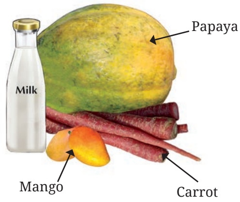
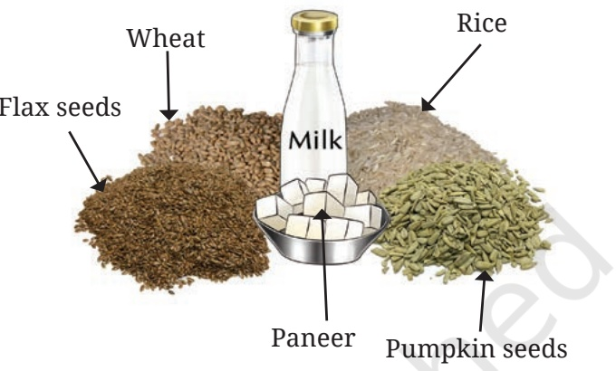
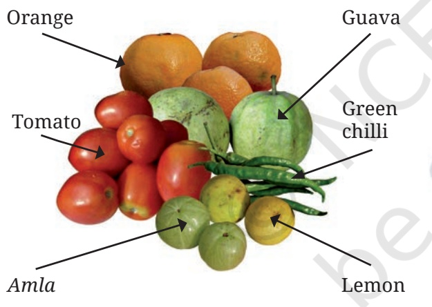
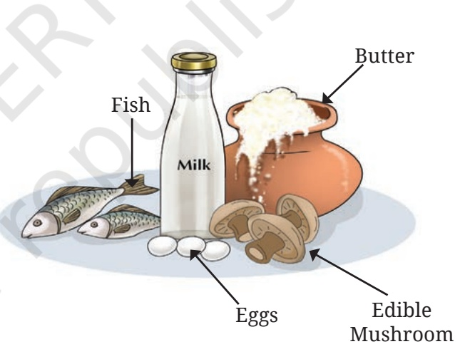

From Fig. 3.5, you have learnt that **vitamins** (A, $\mathbb { B } _ { 1 ^ { \flat } }$ C and D) and **minerals** (calcium, iodine, and iron) are two groups of food components that protect our body from various diseases. But, how can we overcome vitamin and mineral **deficiency diseases** or disorders?

(a) Some sources of Vitamin A

(b) Some sources of Vitamin $B _ { j }$

(c) Some sources of Vitamin C

(d) Some sources of Vitamin D

Fig. 3.6: Some sources of different vitamins

Food components that provide energy, support growth, help repair and protect our body from diseases, and maintain various bodily functions are called **nutrients**. The major nutrients in our food include carbohydrates, proteins, fats, vitamins and minerals.

Vitamins and minerals are also called **protective nutrients.** These nutrients protect our body from diseases and keep us healthy. Your parents may have advised you to have