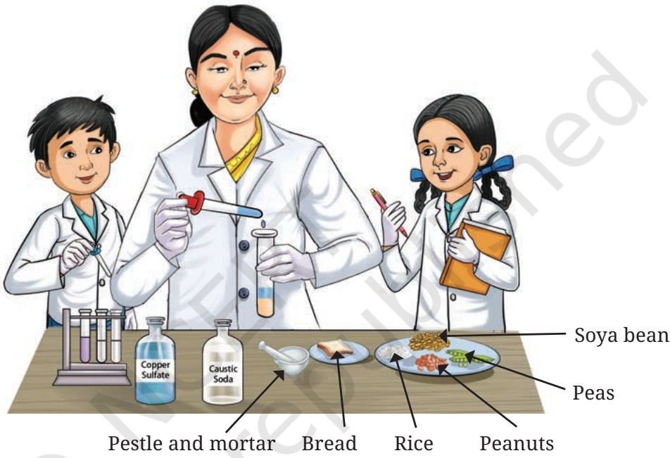

‹ Add 2–3 teaspoons of water to each test tube and shake them well.

‹ Add two drops of copper sulfate solution to each test tube using a dropper.

‹ Now, take another dropper and add 10 drops of caustic soda solution to each tube (Fig. 3.8).

‹ Shake well and leave the test tubes undisturbed for a few minutes.

Fig. 3.8: Testing for the presence of protein in various food items

What did you observe? Did the content of some test tubes turn violet? This violet colour indicates the presence of proteins in the food item. Write your observations in Table 3.3.

What conclusions can you draw from Table 3.3? Which food items show the presence of more than one nutrient? Which food items show the presence of both proteins and fats? Peanuts show the presence of both proteins and fats. This indicates that any food which we eat may contain multiple nutrients. Is there a food item that lacks any of these nutrients? Which of these foods do you consume daily? Try to find out other foods that are good sources of starch, fats, and proteins.