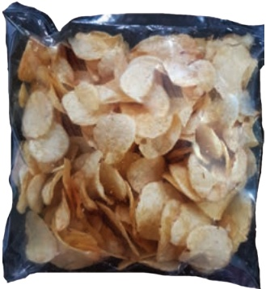
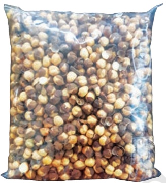

## Activity 3.9: Let us compare

Read the nutritional information given below for a packet of potato wafers and a packet of roasted chana shown here.

(a) Potato wafers

(b) Roasted chana

<table><tr><td rowspan=2 colspan=3>Nutritional Information(per 100 g)</td></tr><tr><td></td><td></td></tr><tr><td>Fats</td><td>35.0 g</td><td></td></tr><tr><td>Carbohydrates</td><td>53.0 g</td><td></td></tr><tr><td>Proteins</td><td>7.0 g</td><td></td></tr><tr><td>Dietary Fibre</td><td>4.8g</td><td></td></tr></table>

<table><tr><td colspan=2>Nutritional Information(per 100 g)</td></tr><tr><td>Energy</td><td>355 kcal(kilocalories)</td></tr><tr><td>Fats</td><td>6.26 g</td></tr><tr><td>Carbohydrates</td><td>58.58 g</td></tr><tr><td>Proteins</td><td>18.64 g</td></tr><tr><td>Dietary Fibre</td><td>16.8 g</td></tr></table>

Based on the nutritional information on the food packets given above, which food would you choose? Why?

Some foods have high calories due to high sugar and fat content. Moreover, they contain very low amounts of proteins, minerals, vitamins, and dietary fibres. These foods are called junk foods. These foods include potato wafers, candy bars and carbonated drinks. Consuming these foods frequently is not good as these are not healthy for our body. They make a person obese. Such a person may suffer from several health problems. You should always remember Dr Poshita’s statement that ʻHealth is the Ultimate Wealth.ʼ We should take care of our body to stay healthy. Eating a balanced diet and avoiding junk food contribute towards