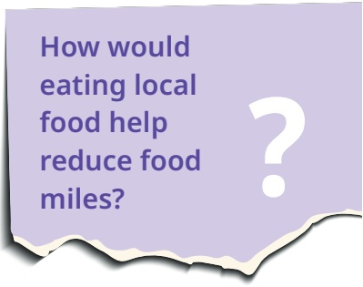

Many people waste food, leaving it unconsumed on their plates. One must remember the time and effort put by our farmers and other community members in getting the food from the farm to our plate. We must take only as much food as we can consume. It would reduce food wastage. Try to find the timeline for the various processes involved in getting the food from farm to plate (Fig. 3.10).

Eat healthy, share, and respect food. Support local producers!

<table><tr><td colspan="3">Keywords</td></tr><tr><td>Carbohydrate</td><td>Millets</td><td>Analyse</td></tr><tr><td>Culinary practices</td><td>Minerals</td><td>Compare</td></tr><tr><td>Deficiency diseases</td><td>Nutrients</td><td>Infer</td></tr><tr><td>Fats</td><td>Proteins</td><td>Interpret</td></tr><tr><td>Food components</td><td>Rickets</td><td></td></tr><tr><td></td><td></td><td>Investigate</td></tr><tr><td>Food miles</td><td>Roughage</td><td>Observe</td></tr><tr><td>Iodized salt</td><td>Scurvy</td><td>Prediction</td></tr><tr><td></td><td>Vitamins</td><td>Survey</td></tr></table>

## Summary

People across India eat diverse types of food, containing various food components.

‹ Choice of food may vary according to the cultivation of food crops in a region, taste preferences, culture and traditions, and so on.