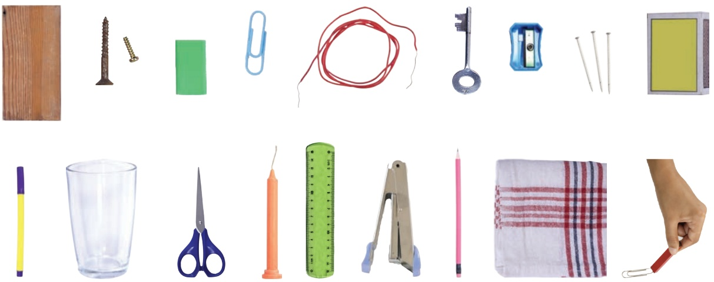

Fig. 4.3: Identifying the materials attracted by a magnet

‹ **Record** your observations in Table 4.1.

Table 4.1: Identifying the materials attracted by a magnet

<table><tr><td rowspan=2>Name of theobject</td><td rowspan=2>Material which theobject is made of(plastic/wood/glass/iron/any other)</td><td colspan=2>Attracted by themagnet (Yes/No)</td></tr><tr><td>Prediction</td><td>Observation</td></tr><tr><td>Pencil</td><td>Wood</td><td></td><td></td></tr><tr><td>Eraser</td><td>Rubber</td><td></td><td></td></tr><tr><td></td><td></td><td></td><td></td></tr><tr><td></td><td></td><td></td><td></td></tr><tr><td></td><td></td><td></td><td></td></tr><tr><td></td><td></td><td></td><td></td></tr><tr><td></td><td></td><td></td><td></td></tr><tr><td></td><td></td><td></td><td></td></tr><tr><td></td><td></td><td></td><td></td></tr><tr><td></td><td></td><td></td><td></td></tr></table>