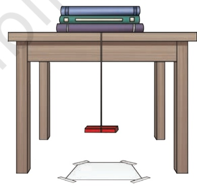
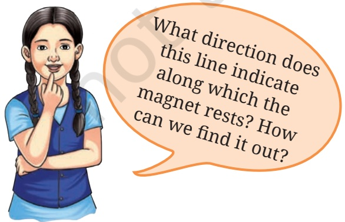

These ends of the magnet are called the two poles of the magnet—the North pole and the South pole. Most of the iron filings stick to the poles of a magnet of any shape.

It is not possible to obtain a magnet with a single pole. If a magnet is broken into smaller pieces, North and South poles always

**Can we find a magnet with a** single pole?

exist in pairs even in the smallest piece of the magnet. A single North pole or a South pole cannot exist.

## 4.3 Finding Directions

## Activity 4.3: Let us experiment

‹ Suspend a bar magnet with a thread tied to the middle of the magnet as shown in Fig. 4.5. You may need to adjust the position of the string till the magnet is balanced horizontally.

‹ Now rotate the magnet gently in the horizontal direction and let it come to rest.

‹ Mark the position corresponding to the ends of the magnet on the ground (or on a piece of paper stuck to the ground). Join these two points on the ground with a line. This line indicates the direction along which the magnet comes to rest.

‹ Now again rotate the magnet by giving a gentle push at its one end and wait till it comes to rest. Does the magnet rest along the same line?

Fig. 4.5: A freely suspended bar magnet

If we have noticed the direction where the Sun rises or sets, we have an approximate idea of where East or West is. Hence, we can locate the direction along which the magnet rests.

Exploring Magnets