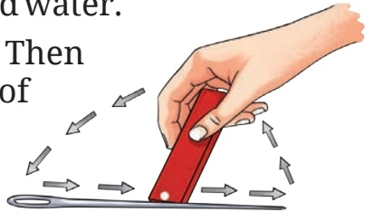
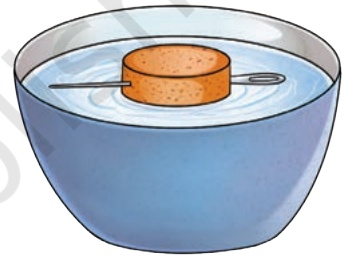

## Activity 4.4: Let us construct

Collect a few materials like a cork piece, iron sewing needle, a permanent bar magnet, a glass bowl, and water.

‹ Place the iron sewing needle on a wooden table. T keep any one pole of the magnet at one end o the needle. Move the magnet over the needle along its length as shown in Fig. 4.7a. When it reaches the other end of the needle, lift it up. G

Bring the same pole of the magnet you started with to the same end of the sewing needle from which you began, and repeat the previous step. Repeat this process at least 30 to 40 times.

Fig. 4.7(a): Making an iron needle a magnet

Bring some iron filings or steel pins near the needle. If the pins or iron filings get attracted to the needle, then that means that the needle has become a magnet. —

Pass this needle through the cork horizontally. Float the cork in a glass bowl filled with water, such that the needle always remains above the level of water as shown in Fig. 4.7b.

‹ When the needle comes to rest, your magnetic compass is ready for use. Note the direction in which either side of the needle points.

Fig. 4.7(b): A compass needle in a bowl of water

Rotate the cork gently and wait till it stops rotating. Repeat this a few more times. Do the ends of the needle always point in the same direction?

Much before the widespread use of the modern magnetic compass (Fig. 4.6), a device similar to the compass needle made by you (Fig. 4.7b) was

**Do you know?**

used by Indians for navigation at sea. It consisted of a magnetised fish-shaped iron piece, kept in a vessel of oil. It was called matsya-yantra (or machchhyantra).

What happens when we bring two magnets closer to each other?