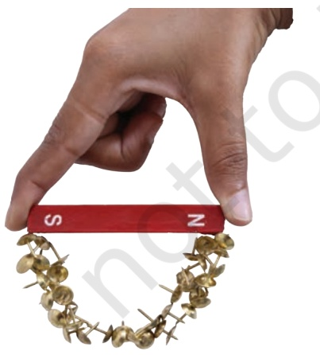

Table 4.2: Observing the effect of magnet through non-magnetic materials

| S. no. | Material placed between the magnet Observations and the compass needle |
| --- | --- |
| 1. | Wood |
| 2. | Cardboard |
| 3. | Plastic |
| 4. | Glass |

You would observe that there is no appreciable change in the deflection of the needle when a sheet of any of the above material is placed between the magnet and the compass needle. Therefore, we can **conclude** that the magnetic effect can act through non-magnetic materials.

## 4.5 Fun with Magnets

After learning about magnets, Reshma was excited and decided to set up some fun activities using magnets at her school fair. You may try making these yourself and may also think of some more fun ideas.

Can we make a garland? (Fig. 4.11)

Fig. 4.11: Magnetic garland

Magnets can move some objects without touching them! Is that not amazing?