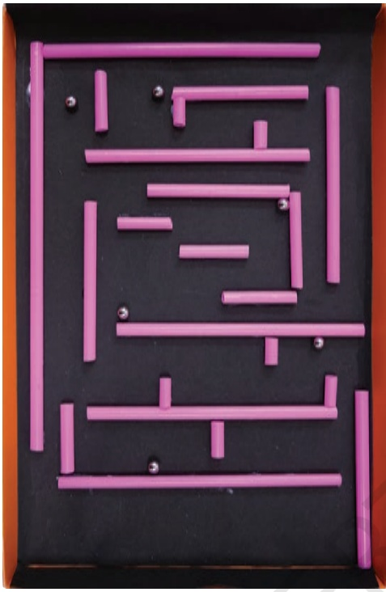
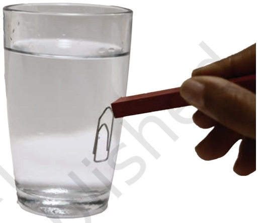
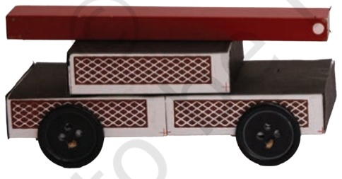
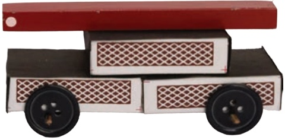

Can we take the steel balls out of the maze by moving a magnet below the cardboard tray? (Fig. 4.12)

Fig. 4.12: Steel balls in a maze

Can we pick out a steel paper clip fallen in water using a magnet, without getting our fingers or the magnet wet? (Fig. 4.13)

Fig. 4.13: Steel paperclip in water

Will the two cars speed towards each other or run away from each other when brought closer? (Fig. 4.14)

Fig. 4.14: Two matchbox-magnet cars with like poles of the magnets facing each other

More to know!

In some magnets, the North and South poles are marked as N and S. In some other magnets, the North pole is indicated by a white dot. Sometimes, the North pole of a magnet is painted red and South pole is painted blue.