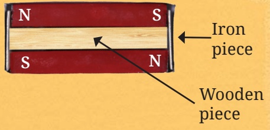

## How to keep the magnets safe?

Magnet says,

“Store me properly. Keep me in pairs with unlike poles on the same side. Keep a piece of wood in between. Place two pieces of soft iron across the ends.”

**More to know!**

“Do not heat me or drop me or hammer me.

Do not keep me near mobile phones or remote controls.”

**Keywords**

## Attraction

Bar magnet

Magnetic compass

Construct

Magnetic materials

Conclude

Experiment

Explore

Non-magnetic materials

Investigate

North pole of a magnet

Observe

Repulsion

Predict

Ring magnet

Record

South pole of a magnet

U-shaped magnet

Iron piece

Wooden piece

**Caution** Have fun, but treat magnets with care.