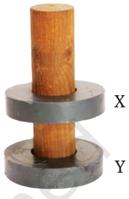
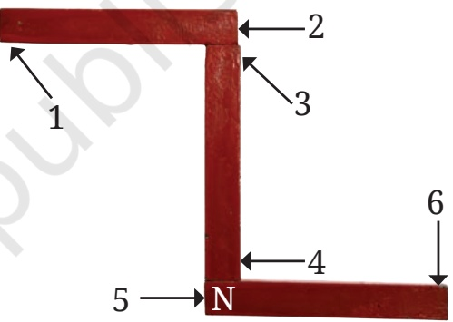

7. A bar magnet has no markings to indicate its poles. How would you find out near which end its North pole is located without using another magnet?

8. If the earth is itself a magnet, can you guess the poles of earth’s magnet by looking at the direction of the magnetic compass?

9. While a mechanic was repairing a gadget using a screw driver, the steel screws kept falling down. Suggest a way to solve the problem of the mechanic on the basis of what you have learnt in this chapter.

10. Two ring magnets X and Y are arranged as shown in Fig. 4.16. It is observed that the magnet X does not move down further. What could be the possible reason? Suggest a way to bring the magnet X in contact with magnet Y, without pushing either of the magnets.

Fig. 4.16: Two ring magnets

11. Three magnets are arranged on a table in the form of the shape shown in Fig. 4.17. What is the polarity, N or S, at the ends 1, 2, 3, 4 and 6 of the magnets? Polarity of one end (5) is given for you.

Fig. 4.17: Three bar magnets

## Learning further

‹ Using 3–4 different magnets, try to lift steel pins or U-clips and check which magnet picks up the largest number of pins. Discuss with your friends why different magnets might have picked up different numbers of pins.

‹ Make a toy ‘Hopping Frog’ as a combined class activity with the help of your teacher. For constructing the toy, fix ring magnets in an alternate North-South fashion along the