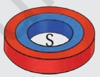
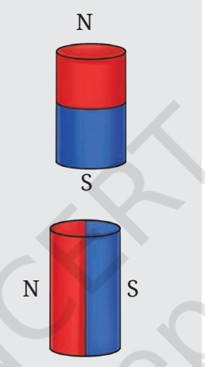
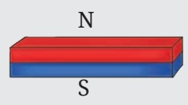
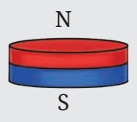
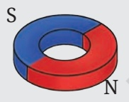
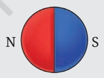

**Magnet says “Humans have made me in different shapes and sizes as per their requirements. However, my poles always occur in pairs, no matter my shape”.**

**Bar Magnet**

**Disc Magnet**

**Cylindrical Magnet**

**Ring Magnet**

## 60 0U

**Spherical Magnet**

Curiosity | Textbook of Science | Grade 6