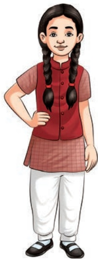
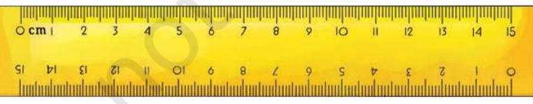
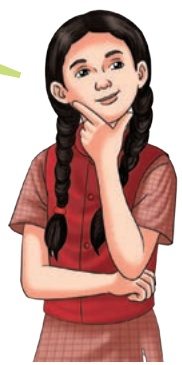

## hapter5 Measurement of Lengthand Motion

Deepa, a curious eleven-year old girl, lives in a town in the state of Haryana. The new school year has started. Deepa needs a new uniform since she has grown taller. Her mother takes her to a cloth shop. She asks for a two-metre cloth piece. The shopkeeper measures the cloth using a metal measuring rod.

Then, the tailor takes her measurements using a flexible measuring tape. Her mother instructs the tailor to increase the length of her uniform by char angula (four fingers width).

0677CH05

## Are

the tape and rod similar to the scale that the elder sister has in her geometry box? What did mother mean by char angula?

Deepa shares her experience with her school friends Anish, Hardeep, Padma, Tasneem and this leads to a discussion amongst them.