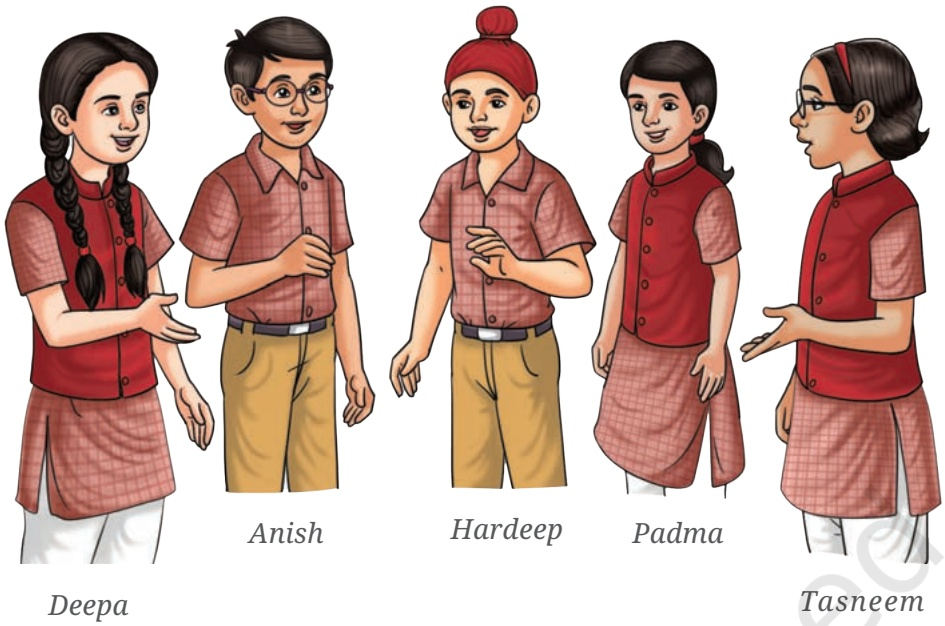
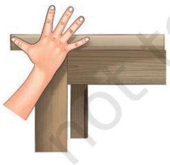

## 5.1 How do we Measure?

Hardeep says, “I have seen my grandmother measuring cloth by the length of her arm.”

“Have you ever seen how a farmer measures length to divide his field into beds? He walks and counts the number of his strides,” says Padma.

“Oh, not just the length of the strides—sometimes they also use the length of their feet to measure,” adds Anish.

Deepa says excitedly, “Measuring length using body parts must be so much fun! Let us also measure something using a body part.”

Fig. 5.1: Use of handspan for measuring

“What should we measure? Okay, let us measure the length of the table in our classroom,” says Tasneem.

Padma adds, “And which body part should we use to measure it?”

Deepa says, “Let us use our handspan. I will show you how to use it (Fig. 5.1). I have seen my mother using it. She calls it balisht.”

Hardeep adds, “Okay. Let us also note down our measurements. ”