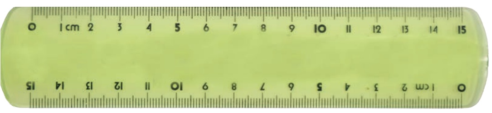

Fig. 5.3: A 15-cm scale

of 1 cm length are further divided into 10 equal parts. The length of one of these smaller parts is called a **millimetre** (**mm**). 1 mm is the smallest value of length that you can measure using this scale. 1 mm is equal to one-tenth of a centimeter (1 mm = 0.1 cm).

For measuring larger lengths, we use a larger unit called a **kilometre** (**km**) which is equal to 1000 metres. And for measuring smaller lengths, we use units such as centimetre or millimetre.

**Would it be convenient to use the unit metre to measure larger lengths, such as the length of a railway track between two cities, or to measure smaller lengths, such as the thickness of a page of a book?**

## 1 km = 1000 m

## 1 m = 100 cm

**1 cm = 10 mm**

In some scales, you might have noticed another scale marking. This scale marking is in inches, where 1 inch = 2.54 cm. In earlier days, units, such as inch and foot, were used to measure length. These units are still used by some people.

**Do you know?**